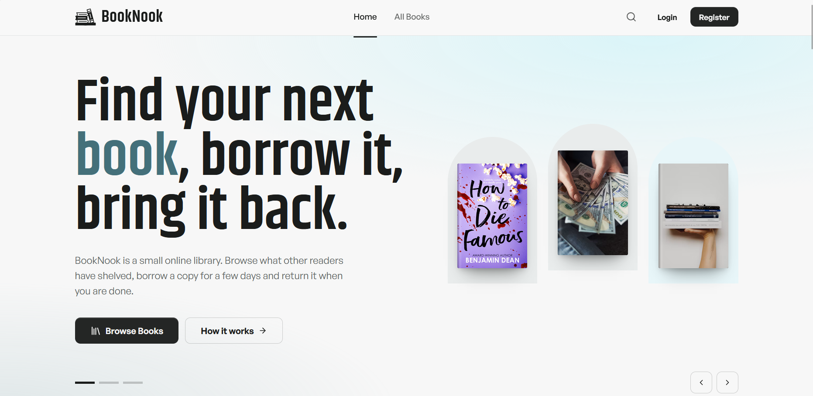
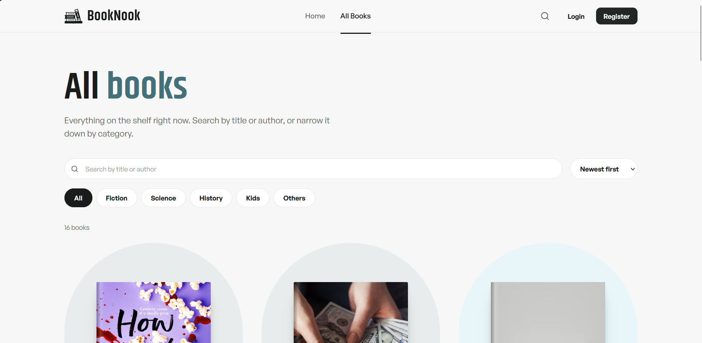
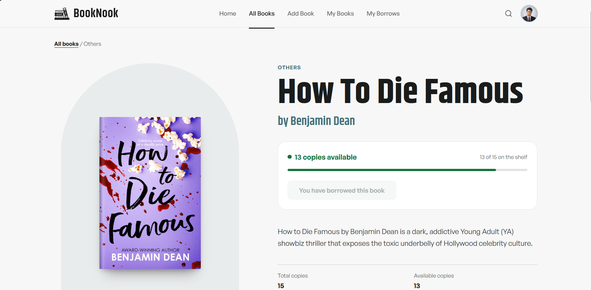
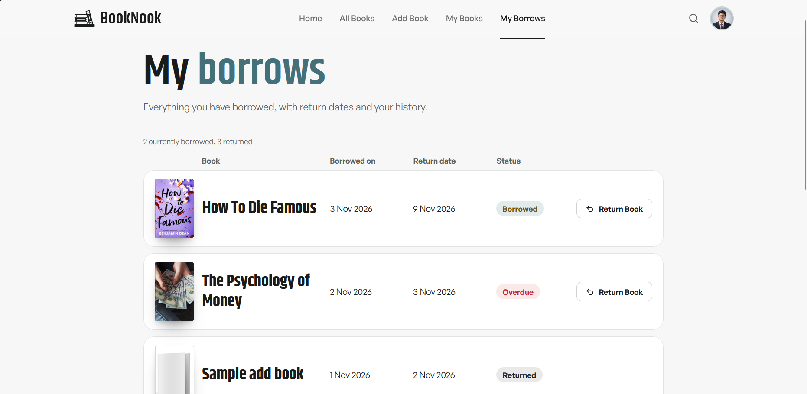
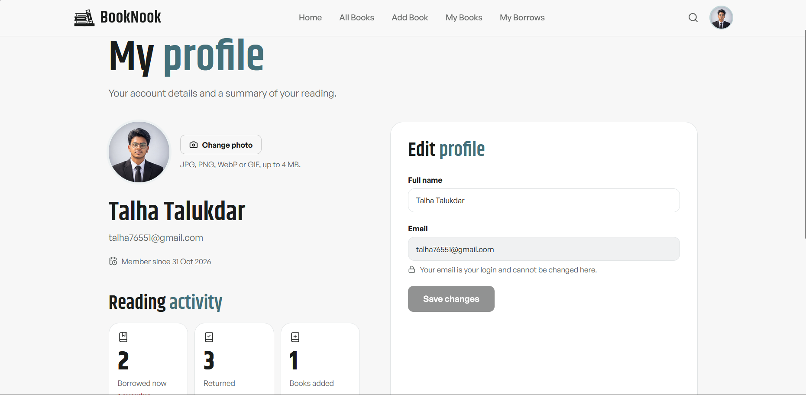

# BookNook Client

**BookNook – A Small Online Library**

BookNook is a modern online library application where users can discover books, explore categories, add books, borrow available copies, and manage their borrowing history.

## Live Application

- **Live Website:** https://booknook-client-olive.vercel.app/
- **Backend API:** https://booknook-server-2ciu.onrender.com
- **Client Repository:** https://github.com/talhatalukdar/booknook-client
- **Server Repository:** https://github.com/talhatalukdar/booknook-server

## Features

- **Editorial Homepage:** Responsive homepage with a three-slide Swiper hero, a search bar with category filter, and layered gradient sections.
- **New Arrivals:** The six latest books, loaded from the database (sorted and limited on the server), shown as two rows of three on desktop.
- **All Books:** Browse, search by title or author, filter by category, sort and paginate.
- **Book Details:** Full book information with real-time copy availability and related books.
- **Authentication:** Email/password registration and login using BetterAuth, plus Google sign-in.
- **Add Books:** Authenticated users add books with a cover image uploaded through ImgBB.
- **My Books:** Edit or delete the books you added (books with active borrows cannot be deleted).
- **Borrow Books:** Borrow an available book with a return date of 1 to 30 days. Books with no copies left show a disabled **Not Available** control instead of Borrow.
- **My Borrows:** Borrowing history with active, returned and overdue status, and one-click returns.
- **User Profile:** Reading statistics, name editing, and profile picture upload with preview.
- **Recently Viewed:** Books you opened recently, stored per account in your own browser only.
- **Protected Routes:** Private pages redirect to Login and bring you back after signing in.
- **Responsive Design:** Mobile, tablet and desktop layouts, loading states, error states, empty states and toast notifications.

## Authentication

BookNook uses BetterAuth with its MongoDB adapter.

Supported sign-in methods:

- Email and password.
- Google OAuth.

Authentication features:

- Persistent sessions that survive page reloads.
- Server-side session validation for private pages.
- JWT generation through the BetterAuth JWT plugin (EdDSA, 15-minute tokens).
- The client sends the token as `Authorization: Bearer <token>`; the Express server verifies it against the JWKS published at `/api/auth/jwks`.
- The token is kept in memory only (never in `localStorage`).

**Google account linking:** New Google accounts can register and sign in. Automatically linking an existing email/password account to Google is not implemented.

## Design and Typography

The interface follows a colour system sampled from reference designs: near-white neutrals, an ice-blue glow, a muted teal-grey surface and charcoal buttons, layered into gradient sections.

Exactly two typefaces are used:

- **Khand** for headings: SemiBold (600) for headings, Bold (700) for book titles and statistics. Self-hosted through `@fontsource/khand`.
- **General Sans** for navigation, buttons, body text, forms and metadata. It is a Fontshare font and is loaded from `public/fonts/GeneralSans-Variable.woff2` (see `public/fonts/README.md`). Without that file the site falls back to the system sans-serif.

The official BookNook logo is in `public/brand/` and is used in the navbar, footer, authentication pages, favicon, Apple icon and Open Graph image.

## Technology Stack

### Frontend
- Next.js App Router
- React
- TypeScript
- Tailwind CSS v4
- Shadcn-style UI components on Radix UI
- Lucide React
- Swiper.js
- Framer Motion (reduced-motion handling)
- Sonner
- React Hook Form
- Zod

### Authentication
- BetterAuth
- BetterAuth MongoDB Adapter
- BetterAuth JWT Plugin
- Google OAuth

### Backend Integration
- Express.js
- MongoDB
- JWT/JWKS verification

### Deployment
- Vercel (Frontend)
- Render (Backend)
- MongoDB Atlas (Database)
- ImgBB (Book cover and profile picture uploads)

## Project Structure

```text
booknook-client/
├── public/
│   ├── brand/          # official logo (SVG)
│   └── fonts/          # General Sans (add the font file here)
├── scripts/
│   └── e2e/            # Playwright end-to-end scripts
├── src/
│   ├── app/            # routes, layouts, API routes (auth, upload)
│   ├── components/     # UI, layout, books, home, auth, borrows
│   ├── fonts/          # self-hosted Khand
│   ├── lib/            # API client, auth, validation, helpers
│   ├── types/
│   └── proxy.ts        # private-route redirect to Login
├── .env.example
├── package.json
└── README.md
```

## Environment Variables

Create a `.env.local` file in the project root:

```bash
cp .env.example .env.local
```

Configure:

```env
BETTER_AUTH_SECRET=
BETTER_AUTH_URL=http://localhost:3000

MONGODB_URI=
DB_NAME=booknook

GOOGLE_CLIENT_ID=
GOOGLE_CLIENT_SECRET=

NEXT_PUBLIC_API_URL=http://localhost:5000

IMGBB_API_KEY=
```

**Important:**

- Never commit `.env.local`.
- `IMGBB_API_KEY` is server-side only: uploads go through the app's own `/api/upload` route, so the key never reaches the browser.
- In production, `BETTER_AUTH_URL` must be the Vercel URL and must equal the backend's `BETTER_AUTH_URL` (it is the JWT issuer and audience).
- `NEXT_PUBLIC_*` values are baked in at build time: redeploy after changing them.
- Add the Google OAuth redirect URI `<your-url>/api/auth/callback/google` in Google Cloud Console.

## Installation and Local Development

```bash
git clone https://github.com/talhatalukdar/booknook-client.git
cd booknook-client
npm install
cp .env.example .env.local   # then fill in the values
npm run dev
```

Open http://localhost:3000 (the backend must be running on the URL in `NEXT_PUBLIC_API_URL`).

Quality checks:

```bash
npm run lint
npx tsc --noEmit
npm run build
```

## Testing

`scripts/e2e/` contains Playwright (Python) end-to-end scripts that drive the real application: authentication, browsing, borrowing and returning, ownership rules, profile upload, per-user recently viewed, typography and colour checks. They need MongoDB, the Express server and this app running; see the comments at the top of each script.

## Deployment

- **Frontend:** Vercel, https://booknook-client-olive.vercel.app/
- **Backend:** Render, https://booknook-server-2ciu.onrender.com
- **Database:** MongoDB Atlas

Step-by-step guide and verification checklist: [DEPLOYMENT.md](https://github.com/talhatalukdar/booknook-client/blob/main/DEPLOYMENT.md)

## Screenshots

### Homepage


### All Books


### Book Details


### My Borrows


### Profile


## Related Repository

BookNook Backend: https://github.com/talhatalukdar/booknook-server

## License

This project was developed as part of Programming Hero Assignment 08.